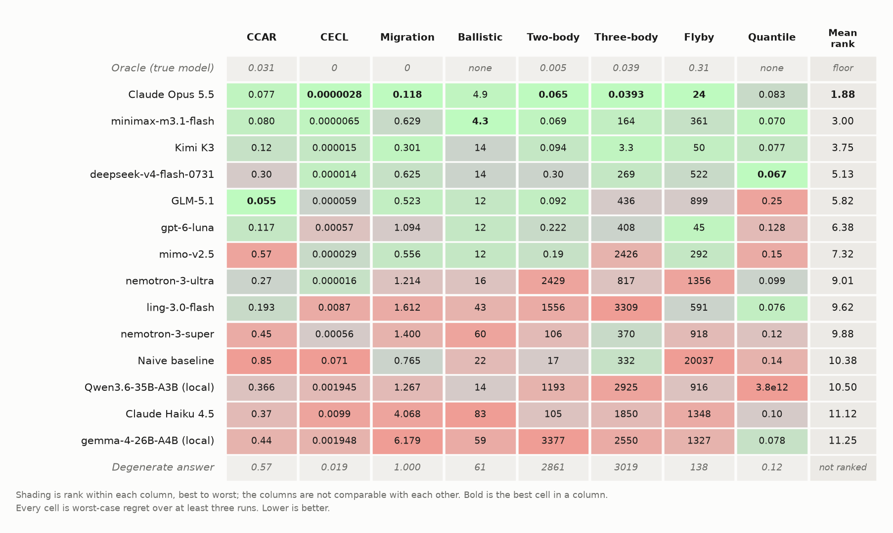

# perEval[^1]

**An [Inspect](https://inspect.aisi.org.uk/)-based evaluation suite for quantitative model development tasks.**

> **Status: working prototype.** Example tasks, baselines, and tests are in place. Sample sizes are small, so the results below are directional. Corners deliberately cut are documented in [docs/limitations.md](docs/limitations.md) rather than hidden.

## Summary

Generic coding and Q&A benchmarks don't test whether an LLM agent can *develop and estimate a statistical model*. perEval probes that corner with tasks drawn from credit risk, macroeconomic loss modeling, and physical mechanisms with known ground truth.

It qualifies a development *process*, not a model. A nine-quarter stress projection cannot be validated against outcomes, because the actuals arrive nine quarters late on a path that is not the scenario path, so the testable object is the process that produced it. [docs/claim.md](docs/claim.md) states what a score supports, what it does not, and how the coverage maps onto SR 26-2.

Three principles shape every task. **Objective verification:** each task has a verifiable target ([docs/task-design.md](docs/task-design.md)). **Scalar regret:** each task scores continuous regret against an oracle or reference, so a task keeps discriminating even when every agent does well, because the magnitudes still separate them. **Pessimistic assessment:** the question is not how well agents do on average but whether the *worst case* is good enough, so every cell is a maximum rather than a mean.

## Tasks

| Task | Type | Challenge |
| --- | --- | --- |
| [CCAR stress loss](docs/tasks/ccar.md) | realistic domain | feature selection under collinearity, transform discovery, bounded functional form, stress extrapolation |
| [CECL lifetime losses](docs/tasks/cecl.md) | synthetic credit portfolio | lifetime allowance, amortization, defaults and prepayments, recoveries, forecast reversion; simulated lifetime-loss prediction intervals |
| [Rating migration under stress](docs/tasks/migration.md) | synthetic credit portfolio | annual-to-quarterly matrix decomposition against the Markov embedding problem, macro-conditional transition matrices, one model projected over three supervisory scenarios |
| [Macro tail quantiles](docs/tasks/quantile.md) | realistic domain | population vs sample quantile, tail extrapolation from 10 observations |
| [Ballistic extrapolation](docs/tasks/ballistic.md) | controlled mechanism | out-of-range extrapolation against velocity-dependent drag |
| [Orbital: two-body, three-body, hyperbolic flyby](docs/tasks/orbital.md) | controlled mechanism | periodic signal recovery, coupled retrograde geometry, angles-only orbit determination |

CCAR and quantile are the original realistic domain tasks. CECL adds a synthetic lifetime-credit-loss task. Migration is the newest and hardest of the credit tasks. The mechanism tasks calibrate the harness across a difficulty gradient with exactly known ground truth.

## Scores

Every cell is the **worst-case regret** over at least three runs, CCAR over eight instances. Lower is better.

> **Not a leaderboard, and not comparable across columns.** The metric differs by column and the scales differ by orders of magnitude, so a number in one column says nothing about another. **Within a column, only order-of-magnitude gaps mean anything.** Re-running the same model on byte-identical instances moved cells by 7.4x, and the reproducibility study found swings up to 30x, so any two cells within a factor of a few are the same cell.

<!-- scores:begin (generated by scripts/render_scores.py; do not edit by hand) -->

<picture>
  <source media="(prefers-color-scheme: dark)" srcset="docs/images/scores-dark.png">
  
</picture>

Shading is rank within that column, green best through red worst; the *Oracle (true model)* and *Degenerate answer* rows are unranked and are shaded neutral. **Bold** marks the best cell in a column. Mean rank is a Borda count within each column and is deliberately the only aggregate, since the cells are not comparable across columns.

<details>

<summary>The same table as text, to read, copy or search</summary>

| Model | CCAR | CECL | Migration | Ballistic | Two-body | Three-body | Flyby | Quantile | Mean rank |
| --- | --- | --- | --- | --- | --- | --- | --- | --- | --- |
| *Oracle (true model)* | *0.031* | *0* | *0* | *none* | *0.005* | *0.039* | *0.31* | *none* | *floor* |
| Claude Opus 5.5 | 0.077 | **0.0000028** | **0.118** | 4.9 | **0.065** | **0.0393** | **24** | 0.083 | **1.88** |
| minimax-m3.1-flash | 0.080 | 0.0000065 | 0.629 | **4.3** | 0.069 | 164 | 361 | 0.070 | 3.00 |
| Kimi K3 | 0.12 | 0.000015 | 0.301 | 14 | 0.094 | 3.3 | 50 | 0.077 | 3.75 |
| deepseek-v4-flash-0731 | 0.30 | 0.000014 | 0.625 | 14 | 0.30 | 269 | 522 | **0.067** | 5.13 |
| GLM-5.1 | **0.055** | 0.000059 | 0.523 | 12 | 0.092 | 436 | 899 | 0.25 | 5.82 |
| gpt-6-luna | 0.117 | 0.00057 | 1.094 | 12 | 0.222 | 408 | 45 | 0.128 | 6.38 |
| mimo-v2.5 | 0.57 | 0.000029 | 0.556 | 12 | 0.19 | 2426 | 292 | 0.15 | 7.32 |
| nemotron-3-ultra | 0.27 | 0.000016 | 1.214 | 16 | 2429 | 817 | 1356 | 0.099 | 9.01 |
| ling-3.0-flash | 0.193 | 0.0087 | 1.612 | 43 | 1556 | 3309 | 591 | 0.076 | 9.62 |
| nemotron-3-super | 0.45 | 0.00056 | 1.400 | 60 | 106 | 370 | 918 | 0.12 | 9.88 |
| *Naive baseline* | *0.85* | *0.071* | *0.765* | *22* | *17* | *332* | *20037* | *0.14* | *10.38* |
| Qwen3.6-35B-A3B (local) | 0.366 | 0.001945 | 1.267 | 14 | 1193 | 2925 | 916 | 3.8e12 | 10.50 |
| Claude Haiku 4.5 | 0.37 | 0.0099 | 4.068 | 83 | 105 | 1850 | 1348 | 0.10 | 11.12 |
| gemma-4-26B-A4B (local) | 0.44 | 0.001948 | 6.179 | 59 | 3377 | 2550 | 1327 | 0.078 | 11.25 |
| *Degenerate answer* | *0.57* | *0.019* | *1.000* | *61* | *2861* | *3019* | *138* | *0.12* | *not ranked* |

Also in [docs/scores.csv](docs/scores.csv), which carries the per-column ranks as well and makes a changed score a reviewable diff rather than a new image.

</details>

<!-- scores:end -->

### Findings

**Claude Opus 5.5 takes five of eight columns and the aggregate, but judged on its worst pass only three of those leads survive.** Three-body at 0.0432 against 3.3 is a 76x margin; CECL and migration are closer to 1.5x, measured on three instances. The columns are not one distribution: three-body is the most stable cell the suite has measured, while its flyby spans 434x on a single instance.

**Three-body is closed and the flyby is not.** Opus's 0.0393 sits on the oracle's 0.039, so that column has a ceiling rather than headroom. On the flyby, eleven of the fourteen ranked rows are worse than the degenerate answer, and the leader fails the task outright one pass in three. Leading that column is not the same as solving it.

**Migration is the hardest column in the suite.** Only Opus and Kimi K3 land inside the competent one-factor reference's 0.368, and seven of the fourteen ranked rows score worse than the degenerate answer, the most of any column.

**Three rows rank below the naive baseline.** The *naive baseline* is the obvious wrong method, not the floor, and Claude Haiku 4.5 and both local rows fall through it. The *degenerate answer* is a single constant with no interval, and it reads differently in every column on purpose: ling is within a few percent of the lowest quantile score in the table and still worse than a constant on three-body.

**Local hardware reaches every column but places near the bottom.** The two local rows ran on one 48 GB Mac Mini. Both complete all eight tasks, and both land below the naive baseline. Their cells are also the noisiest in the table: Qwen's quantile cell of 3.8e12 comes from a single block of one hundred in one of three seeds where a Student's t fit diverged, while its other two seeds scored 0.061 and 0.075. See [docs/local-models.md](docs/local-models.md).

### Reading The Cells

Row labels name the model, not the endpoint that served it, and serving provenance is not controlled ([detail](docs/limitations.md#serving-provenance-is-not-controlled)). A cell is reported only if none of its runs failed for reasons outside the agent's control, with the recorded exceptions noted in [docs/models.md](docs/models.md). Two rows were measured with three draws per instance rather than one and are reported on a matched convention that keeps them comparable. CCAR's response law is now drawn per instance rather than fixed and published, which changed the answer key rather than the question, so archived runs stay in the column ([detail](docs/limitations.md#the-ccar-response-law-was-public)).

Per-row provenance, measurement conventions, and the caveats behind individual cells are in [docs/models.md](docs/models.md). Per-task scoring definitions are in the task docs linked under [Tasks](#tasks). Everything known to be wrong or unresolved is in [docs/limitations.md](docs/limitations.md).

## Quick Start

```bash
pip install -e .
inspect eval pereval/tasks/ccar/task.py --model <provider/model>        # needs Docker
```

Every task also ships reference solvers that run without a model and bracket the score from both ends:

```bash
inspect eval pereval/tasks/ccar/task.py -T baseline=vasicek --model mockllm/model   # competent
inspect eval pereval/tasks/ccar/task.py -T baseline=naive   --model mockllm/model   # floor
```

Use `-T n_instances=N` for many fresh instances, and `-T repeats=K` to rerun the agent on the *same* instance, which separates method instability from instance difficulty ([why that is the number to watch](docs/limitations.md#same-instance-stability)). See [docs/setup.md](docs/setup.md) for the Python environment, Docker install, and model credentials.

## Layout

```
pereval/            Python package: Inspect tasks and scorers
  tasks/ccar/       FRED-calibrated macro + Vasicek generator, task, OLS + Vasicek baselines
  tasks/cecl/       synthetic lifetime loss generator, task, cohort + naive baselines
  tasks/migration/  rating transition generator, task, one-factor + single-driver + no-migration baselines
  tasks/quantile/   screened FRED YoY snapshot, generator, task, six reference estimators
  tasks/ballistic/  generator, Inspect task, Docker sandbox, quadratic baseline
  tasks/orbit/      two-body, three-body, and hyperbolic-flyby generators, tasks, baselines
  scorers/          oracle-anchored interval scorer (linear and circular), pinball regret
scripts/            FRED enumeration and screening, transcript export, paired analysis
tests/              scorer validation suite + generator/scorer integration
runs/, logs/        archived transcripts and Inspect logs behind every published table
docs/               claim and scope, task design, limitations, row provenance, per-task scores
```

## License

MIT for this repository's own code. The ballistic task depends on [py-ballisticcalc](https://github.com/o-murphy/py-ballisticcalc) (LGPL-3.0), used as an unmodified installed dependency and not redistributed here, so it imposes no obligations on this code.

[^1]: *pereval* (Russian: перевал, "mountain pass"): the hard route through, not around. It also happens to end in `eval`.
