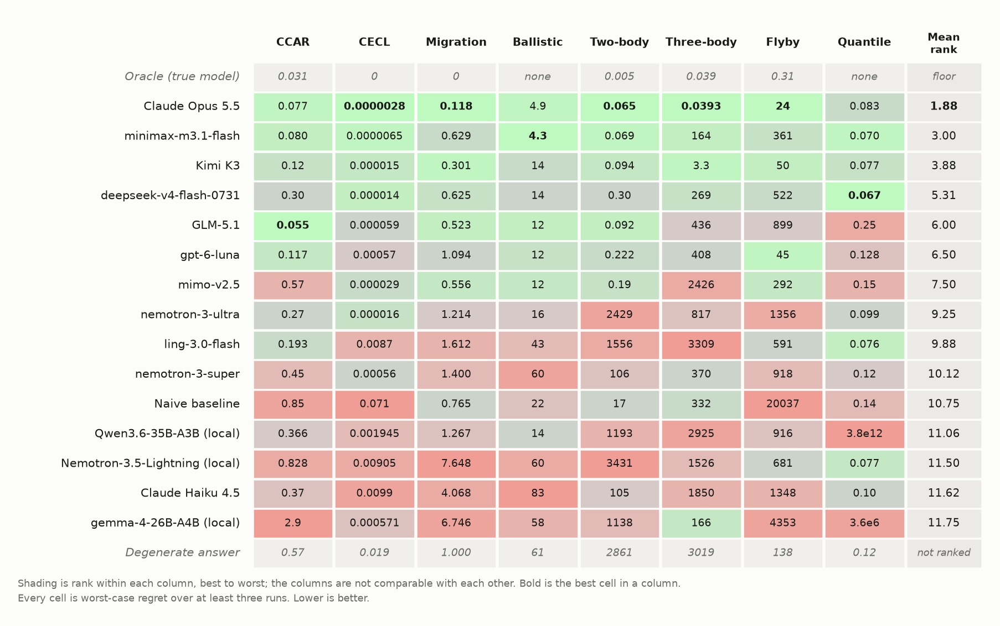

# perEval[^1]

**An [Inspect](https://inspect.aisi.org.uk/)-based evaluation suite for quantitative model development tasks.**

> **Status: working prototype.** Example tasks, baselines, and tests are in place. Sample sizes are small, so the results below are directional. Corners deliberately cut are documented in [docs/limitations.md](docs/limitations.md) rather than hidden.

## Summary

Generic coding and Q&A benchmarks don't test whether an LLM agent can *develop and estimate a statistical model*. perEval probes that corner with tasks drawn from credit risk, macroeconomic loss modeling, and physical mechanisms with known ground truth.

It qualifies a development *process*, not a model. A nine-quarter stress projection cannot be validated against outcomes, because the actuals arrive nine quarters late on a path that is not the scenario path, so the testable object is the process that produced it. [docs/claim.md](docs/claim.md) states what a score supports, what it does not, and how the coverage maps onto SR 26-2 and the OCC's November 2026 examiner framework for agentic systems, which grades such systems by what a failure would cost rather than by how advanced they are.

Three principles shape every task:

- **Objective verification:** each task has a verifiable target ([docs/task-design.md](docs/task-design.md)).
- **Scalar regret:** each task scores continuous regret against an oracle or reference, so a task keeps discriminating even when every agent does well, because the magnitudes still separate them.
- **Pessimistic assessment:** the question is not how well agents do on average but whether the *worst case* is good enough, so every cell is a maximum rather than a mean.

## Tasks

| Task | Type | Challenge |
| --- | --- | --- |
| [CCAR stress loss](docs/tasks/ccar.md) | realistic domain | feature selection under collinearity, transform discovery, bounded functional form, stress extrapolation |
| [CECL lifetime losses](docs/tasks/cecl.md) | synthetic credit portfolio | lifetime allowance, amortization, defaults and prepayments, recoveries, forecast reversion; simulated lifetime-loss prediction intervals |
| [Rating migration under stress](docs/tasks/migration.md) | synthetic credit portfolio | annual-to-quarterly matrix decomposition against the Markov embedding problem, macro-conditional transition matrices, one model projected over three supervisory scenarios |
| [Macro tail quantiles](docs/tasks/quantile.md) | realistic domain | population vs sample quantile, tail extrapolation from 10 observations |
| [Ballistic extrapolation](docs/tasks/ballistic.md) | controlled mechanism | out-of-range extrapolation against velocity-dependent drag |
| [Orbital: two-body, three-body, hyperbolic flyby](docs/tasks/orbital.md) | controlled mechanism | periodic signal recovery, coupled retrograde geometry, angles-only orbit determination |

CCAR and quantile are the original realistic domain tasks. CECL adds a synthetic lifetime-credit-loss task. Migration is the newest and hardest of the credit tasks. The mechanism tasks calibrate the harness across a difficulty gradient with exactly known ground truth.

## Scores

Every cell is the **worst-case regret** over at least three runs, CCAR over eight instances. Lower is better.

> **Not a leaderboard.** Sample size is insufficient to draw such conclusions. **Not comparable across columns.** The metric differs by column.

<!-- scores:begin (generated by scripts/render_scores.py; do not edit by hand) -->

<picture>
  <source media="(prefers-color-scheme: dark)" srcset="docs/images/scores-dark.png">
  
</picture>

Shading is rank within that column, green best through red worst; the *Oracle (true model)* and *Degenerate answer* rows are unranked and are shaded neutral. **Bold** marks the best cell in a column. Mean rank is a Borda count within each column and is deliberately the only aggregate, since the cells are not comparable across columns.

<details>

<summary>The same table as text, to read, copy or search</summary>

| Model | CCAR | CECL | Migration | Ballistic | Two-body | Three-body | Flyby | Quantile | Mean rank |
| --- | --- | --- | --- | --- | --- | --- | --- | --- | --- |
| *Oracle (true model)* | *0.031* | *0* | *0* | *none* | *0.005* | *0.039* | *0.31* | *none* | *floor* |
| Claude Opus 5.5 | 0.077 | **0.0000028** | **0.118** | 4.9 | **0.065** | **0.0393** | **24** | 0.083 | **1.88** |
| minimax-m3.1-flash | 0.080 | 0.0000065 | 0.629 | **4.3** | 0.069 | 164 | 361 | 0.070 | 3.00 |
| Kimi K3 | 0.12 | 0.000015 | 0.301 | 14 | 0.094 | 3.3 | 50 | 0.077 | 3.88 |
| deepseek-v4-flash-0731 | 0.30 | 0.000014 | 0.625 | 14 | 0.30 | 269 | 522 | **0.067** | 5.31 |
| GLM-5.1 | **0.055** | 0.000059 | 0.523 | 12 | 0.092 | 436 | 899 | 0.25 | 6.00 |
| gpt-6-luna | 0.117 | 0.00057 | 1.094 | 12 | 0.222 | 408 | 45 | 0.128 | 6.50 |
| mimo-v2.5 | 0.57 | 0.000029 | 0.556 | 12 | 0.19 | 2426 | 292 | 0.15 | 7.50 |
| nemotron-3-ultra | 0.27 | 0.000016 | 1.214 | 16 | 2429 | 817 | 1356 | 0.099 | 9.25 |
| ling-3.0-flash | 0.193 | 0.0087 | 1.612 | 43 | 1556 | 3309 | 591 | 0.076 | 9.88 |
| nemotron-3-super | 0.45 | 0.00056 | 1.400 | 60 | 106 | 370 | 918 | 0.12 | 10.12 |
| *Naive baseline* | *0.85* | *0.071* | *0.765* | *22* | *17* | *332* | *20037* | *0.14* | *10.75* |
| Qwen3.6-35B-A3B (local) | 0.366 | 0.001945 | 1.267 | 14 | 1193 | 2925 | 916 | 3.8e12 | 11.06 |
| Nemotron-3.5-Lightning (local) | 0.828 | 0.00905 | 7.648 | 60 | 3431 | 1526 | 681 | 0.077 | 11.50 |
| Claude Haiku 4.5 | 0.37 | 0.0099 | 4.068 | 83 | 105 | 1850 | 1348 | 0.10 | 11.62 |
| gemma-4-26B-A4B (local) | 2.9 | 0.000571 | 6.746 | 58 | 1138 | 166 | 4353 | 3.6e6 | 11.75 |
| *Degenerate answer* | *0.57* | *0.019* | *1.000* | *61* | *2861* | *3019* | *138* | *0.12* | *not ranked* |

Also in [docs/scores.csv](docs/scores.csv), which carries the per-column ranks as well and makes a changed score a reviewable diff rather than a new image.

</details>

<!-- scores:end -->

The table illustrates that the framework discriminates across a diverse set of agents:

- **No column is saturated.** The shading shows a consistent gradient in every column, with near-frontier models ahead of local ones on most tasks.
- **No column has a floor.** In all eight, at least one ranked row scores worse than the degenerate constant, so the trivial answer is nowhere a safe one.
- **The columns are not redundant.** The participation ratio across the physics and statistics axes is 2.53, where eight columns measuring one underlying thing would collapse towards 1, and nine of the fifteen ranked rows move two or more places between those axes ([detail](docs/limitations.md#the-overall-rank-depends-on-the-task-mix)).

Per-row provenance, measurement conventions, and the caveats behind individual cells are in [docs/models.md](docs/models.md). Per-task scoring definitions are in the task docs linked under [Tasks](#tasks). Local models ran on one 48 GB Mac Mini ([detail](docs/local-models.md)). Everything known to be wrong or unresolved is in [docs/limitations.md](docs/limitations.md).

## Quick Start

```bash
pip install -e .
inspect eval pereval/tasks/ccar/task.py --model <provider/model>        # needs Docker
```

Every task also ships reference solvers that run without a model and bracket the score from both ends:

```bash
inspect eval pereval/tasks/ccar/task.py -T baseline=vasicek --model mockllm/model   # competent
inspect eval pereval/tasks/ccar/task.py -T baseline=naive   --model mockllm/model   # floor
```

Use `-T n_instances=N` for many fresh instances, and `-T repeats=K` to rerun the agent on the *same* instance, which separates method instability from instance difficulty ([why that is the number to watch](docs/limitations.md#same-instance-stability)). See [docs/setup.md](docs/setup.md) for the Python environment, Docker install, and model credentials.

## Layout

```
pereval/            Python package: Inspect tasks and scorers
  tasks/ccar/       FRED-calibrated macro + Vasicek generator, task, OLS + Vasicek baselines
  tasks/cecl/       synthetic lifetime loss generator, task, cohort + naive baselines
  tasks/migration/  rating transition generator, task, one-factor + single-driver + no-migration baselines
  tasks/quantile/   screened FRED YoY snapshot, generator, task, seven reference estimators
  tasks/ballistic/  generator, Inspect task, Docker sandbox, quadratic baseline
  tasks/orbit/      two-body, three-body, and hyperbolic-flyby generators, tasks, baselines
  scorers/          oracle-anchored interval scorer (linear and circular), pinball regret
scripts/            FRED enumeration and screening, transcript export, paired analysis
tests/              scorer validation suite + generator/scorer integration
runs/, logs/        archived transcripts and Inspect logs behind every published table
docs/               claim and scope, task design, limitations, row provenance, per-task scores
```

## License

MIT for this repository's own code. The ballistic task depends on [py-ballisticcalc](https://github.com/o-murphy/py-ballisticcalc) (LGPL-3.0), used as an unmodified installed dependency and not redistributed here, so it imposes no obligations on this code.

[^1]: *pereval* (Russian: перевал, "mountain pass"): the hard route through, not around. It also happens to end in `eval`.
