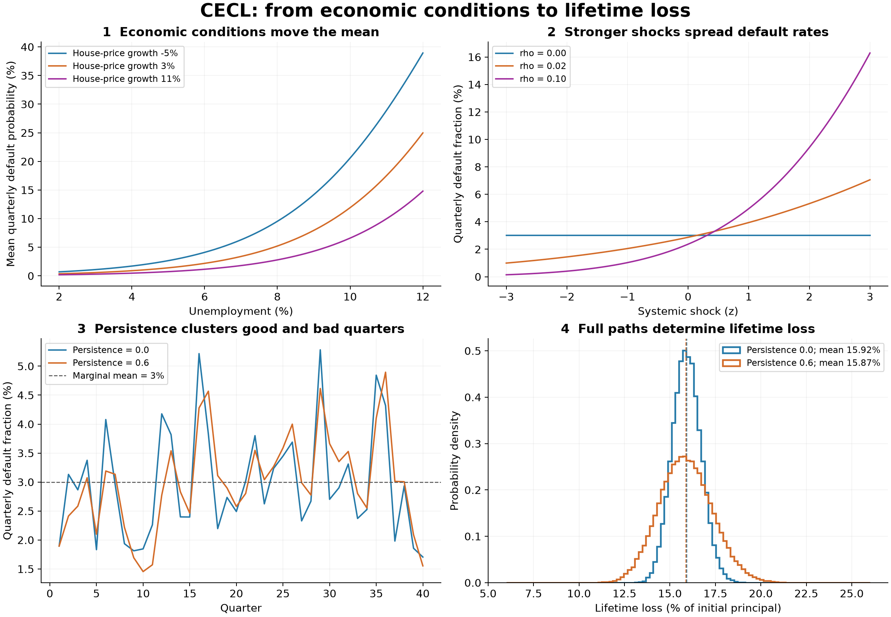

# CECL Lifetime Expected Credit Losses

Lifetime expected credit loss for a synthetic portfolio of amortizing term loans. Unlike CCAR's nine-quarter default-rate projection, the output is expected net principal loss in dollars over each pool's remaining contractual life, with a central 95% prediction interval. It is a modelling benchmark, not an accounting compliance assessment.

```bash
inspect eval pereval/tasks/cecl/task.py --model <provider/model>                 # needs Docker
inspect eval pereval/tasks/cecl/task.py -T baseline=cohort --model mockllm/model
inspect eval pereval/tasks/cecl/task.py -T baseline=naive  --model mockllm/model
inspect eval pereval/tasks/cecl/task.py -T n_instances=9 -T seed=123 -T repeats=3 --model <provider/model>
inspect eval pereval/tasks/cecl/task.py -T scenario=adverse -T forecast_quarters=4 -T reversion_quarters=0
```

`n_instances=3` rotates the baseline, adverse and benign paths. Other options are `n_history` (80), `forecast_quarters` (8), `reversion_quarters` (4), `repeats` (1), `message_limit` (500) and `oracle_n` (10,000 paths, minimum 100). Pin `scenario` for paired sensitivity comparisons.

## Task

The agent receives four files and submits `predictions.csv` with `pool_id,ecl,ecl_lower,ecl_upper` in dollars.

| File | Contents |
| --- | --- |
| `history.csv` | 80 noisy quarterly observations per segment of PD, LGD, conditional prepayment, unemployment and house-price growth |
| `forecast.csv` | one macroeconomic path over the forecast period |
| `pools.csv` | 12 pools across three segments, with randomised balances and remaining terms of 4, 12, 24 and 40 quarters |
| `policy.json` | forecast and reversion lengths, `rho`, `persistence` |

The interval is for **that pool's own** future lifetime loss under the supplied scenario, not a confidence interval for the estimated allowance and not a share of a portfolio band. Each is scored separately, and endpoints must satisfy `0 <= lower <= upper <= B`. Expected dollar losses add across pools; loss rates and interval endpoints do not.

A pool is an aggregate exposure, not one loan: a segment fixes the PD, LGD and prepayment laws, and its four pools differ only in balance and remaining term, so a short pool matures before reversion while a long one is exposed to the tail assumptions. Segments A, B and C are labels, not ordered ratings.

The task tests lifetime versus annual horizons, amortization, competing exits, segment differences, net recovery severity, forecast sensitivity and reversion.

## Data

The generator produces aggregate pools of funded amortizing term loans with equal quarterly principal repayment, no drawdowns, renewals or extensions. Balances are drawn uniformly from $1M to $10M. There are no loan counts, borrower records, credit scores, collateral, interest rates or seasoning: the benchmark is a generic term-loan book rather than a retail, mortgage or commercial one. The binomial parameter 10,000 used for measurement noise is not a loan count, and `oracle_n` counts simulated futures, not borrowers.

Each rate is logistic in two macro drivers, with coefficients redrawn per instance and per segment:

```math
\eta_q = \beta_0 + \beta_u x_{u,q} + \beta_h x_{h,q}, \qquad m_q = \frac{1}{1+\exp(-\eta_q)},
\qquad x_{u,q}=u_q-5, \qquad x_{h,q}=\frac{h_q-0.03}{0.04}.
```

Unemployment enters in percentage points displaced from 5%, house-price growth as a fraction displaced from 3% and scaled by four points. For PD the unemployment coefficient is positive and the house-price coefficient negative. Historical observations are noisy measurements of these conditional means; ground truth uses the latent expectations. This is a synthetic mechanism and does not inherit CCAR's FRED calibration.

Mean rates follow the forecast path, then revert linearly to the segment's historical mean over `R` quarters, then hold. The oracle's historical target is the mean of the latent rates over the supplied history; the agent must estimate it from the noisy ones.

**Accounting.** Default is applied to beginning-of-quarter principal, survivors may then prepay in full, and the remainder makes its scheduled principal payment. Exited exposure never returns and nothing is discounted.

```math
\mathrm{EAD}_q=B\left(1-\frac{q-1}{T}\right)S_{q-1},
\qquad S_0=1,\quad S_q=S_{q-1}(1-d_q)(1-p_q).
```

**Simulation.** The default fraction on a path is CCAR's bounded probit shock around the logistic mean, with a stationary AR(1) systemic shock:

```math
d_q=\Phi\!\left(\frac{\Phi^{-1}(m_q)+\sqrt{\rho}\,z_q}{\sqrt{1-\rho}}\right),
\qquad z_1\sim\mathcal{N}(0,1),\quad z_{q+1}=\phi z_q+\sqrt{1-\phi^2}\,\epsilon_{q+1}.
```

The scaling preserves the marginal mean, so `E[d_q] = m_q` and `Corr(z_q, z_{q+k}) = phi^k`. The public policy supplies `rho = 0.02` and `persistence = 0.6`; both are disclosed, so this version tests propagation of a known stochastic process rather than inference of it. Pools in the same segment share shocks across all remaining terms, and segments are independent. LGD and prepayment stay deterministic conditional rates. This is a large-homogeneous-pool approximation with no finite-borrower sampling noise.

Lifetime loss is computed **along each path and then averaged**, not by running the recursion once at mean PDs:

```math
L^{(n)}=\sum_{q=1}^{T}d_q^{(n)}\,\mathrm{EAD}_q^{(n)}\,\mathrm{LGD}_q,
\qquad \widehat{\mathrm{ECL}}=\frac{1}{N}\sum_n L^{(n)},
\qquad \mathrm{PI}_{95\%}=\left[Q_{0.025}(L),\,Q_{0.975}(L)\right].
```

That distinction is the point of the simulation mode: with persistent shocks, high-default paths lose exposed principal earlier, so future default fractions and surviving EAD are dependent and the product of their averages does not recover expected loss.



The panels show each ingredient in isolation: economic conditions move the bounded logistic mean; `rho` sets dispersion around it; persistence lengthens runs of high or low defaults without changing the marginal mean; and the combination of risk with runoff widens the lifetime-loss distribution and shifts its mean. Reproduce with `python scripts/plot_cecl_functional_form.py`.

## Scoring

The headline metric is `ecl_regret`, the balance-weighted squared error of pool loss rates:

```math
R_{\mathrm{ECL}}=\sum_i \frac{B_i}{\sum_j B_j}\left(\frac{\widehat{\mathrm{ECL}}_i-\mathrm{ECL}_i}{B_i}\right)^2.
```

Lower is better, opposite errors in different pools cannot cancel, and it is not comparable with CCAR's Winkler regret. Also reported: loss-rate MAE in basis points, completion, portfolio dollars and signed bias for complete submissions.

**Intervals are a diagnostic, not a ranking axis**, because the shock law is disclosed to the agent. They are scored with the suite's shared 95% Winkler formula on loss rates, balance-weighted, reporting `winkler_agent`, `winkler_oracle`, the signed `winkler_regret_raw` and its clipped counterpart, coverage and mean width.

Missing, malformed, duplicate, non-finite or out-of-bounds entries take the suite penalty per pool, `max(degenerate, 5 x oracle)`. Since the oracle's squared error is zero, that reduces to the zero-allowance score, so a missing answer can never beat the zero anchor while a valid but poor answer can score worse than it.

Three anchors: the exact hidden conditional mean at zero regret, `cohort`, which fits segment logit-linear rates from public inputs and propagates the disclosed shocks over 20,000 paths, and `naive`, which is historical PD times LGD times remaining term times balance, capped at balance, ignoring runoff and the forecast.

The oracle estimates means and quantiles on one stream and evaluates on an independent one, so the reference is a finite Monte Carlo estimate rather than an exact floor. `ecl_mc_se` reports its precision, and changing `oracle_n` changes the scoring reference, so small differences should be checked against it before being read.

## Results

Worst-case regret over three instances. Lower is better.

<!-- scores:begin (generated by scripts/render_scores.py; do not edit by hand) -->

| Model | CECL |
| --- | --- |
| *Oracle (true model)* | *0* |
| Claude Opus 5.5 | **0.0000028** |
| minimax-m3.1-flash | 0.0000065 |
| deepseek-v4-flash-0731 | 0.000014 |
| Kimi K3 | 0.000015 |
| nemotron-3-ultra | 0.000016 |
| mimo-v2.5 | 0.000029 |
| GLM-5.1 | 0.000059 |
| nemotron-3-super | 0.00056 |
| gpt-6-luna | 0.00057 |
| Qwen3.6-35B-A3B (local) | 0.001945 |
| gemma-4-26B-A4B (local) | 0.001948 |
| ling-3.0-flash | 0.0087 |
| Claude Haiku 4.5 | 0.0099 |
| *Degenerate answer* | *0.019* |
| *Naive baseline* | *0.071* |

<!-- scores:end -->

**The column is two groups and a gap, not a gradient.** Six models land between 0.0000065 and 0.000059 with interval coverage 0.93 to 0.96, then nothing until the second group, whose coverage falls away to 0.84, 0.69, 0.67 and 0.48. Within the leading six the spread is a factor of nine on three instances, which this suite cannot resolve, so read the column as whether a model built the simulation and calibrated to it rather than as an ordering.

No model is worse than the degenerate answer here. Only the naive baseline is, which makes this the one column where the naive method is clearly the floor and nothing falls through it.

The two local rows sit between the groups and their ordering is not meaningful: the cells differ by 0.15%, far below anything this suite resolves ([detail](../local-models.md)).

## Solutions

The strongest submissions do the same four things, and the task rewards executing disclosed mechanics exactly rather than inventing anything.

**Fit the rates as what they are.** Per segment, a quasi-binomial logit GLM for PD and prepayment on unemployment and house-price growth, which targets the conditional mean directly on a bounded rate, and OLS for LGD. Fits reach R-squared of 0.9 to 0.99, so the response laws are recoverable from the noisy history; getting them wrong is not where this task separates models.

**Apply the reversion policy literally.** Forecast path for eight quarters, linear reversion to the historical sample mean over four, then hold to maturity. The reversion estimate must come from the noisy observations, which is the one place estimation error enters the mean rates.

**Simulate, do not shortcut.** Draw the disclosed AR(1) probit shocks, shared within a segment, and run the full balance recursion on every path. The leaders use 200,000 paths where the reference uses 20,000. Averaging path losses rather than running the recursion once at mean PD is the difference the simulation mode exists to measure.

**Take the interval from the simulated distribution.** The 2.5% and 97.5% quantiles of that pool's own path losses. Rows that score well on the mean and badly on coverage almost always constructed the interval some other way.

## Limitations

**There is no feature-selection challenge.** The history has exactly two macro columns and both are true drivers, so there is nothing comparable to CCAR's collinear distractors. The prompt also supplies the accounting recursion, event ordering, amortization convention and reversion blend in full. Implementing them correctly is tested; discovering or choosing them is not.

**The functional family is fixed and logistic**, so the task does not establish robustness across alternative response families. Parameters vary, families do not.

**Uncertainty dynamics are disclosed, not inferred.** Historical measurement noise contains no realizations of future systemic shocks, and hiding `rho` and `persistence` without redesigning the history would make them unidentifiable. Learning them from realized defaults is future work.

**Scope.** This covers funded term-loan principal only, and excludes revolving commitments, renewals, purchased credit-deteriorated assets, collateral-dependent measurement, accrued interest, qualitative overlays, discounted cash flow, scenario mixtures, and management's selection of reasonable and supportable forecasts. The [interagency policy statement](https://www.federalreserve.gov/frrs/guidance/interagency-policy-statement-on-allowances-for-credit-losses.htm) motivates the task; the supplied path, reversion policy and conventions are benchmark assumptions, not prescribed choices, and nothing here certifies an allowance under ASC 326.

**A point-only legacy mode exists** behind `-T simulation=false`, scoring `ecl_regret` alone against the analytic conditional mean with no interval requested. Its scores are not interchangeable with interval results and must not be pooled with them.

**One prompt ambiguity has already cost a cell.** An early run implemented the shock law correctly and still scored coverage 0.461, because the prompt said "aggregate lifetime loss" and the model built one portfolio band and allocated it across pools in proportion to expected loss. Pool losses share segment shocks and do not diversify away, so that construction is far too narrow per pool. Reconstructing the misreading on the same instance reproduced its width to within five percent, and re-running with only the interval wording changed moved coverage from 0.461 to 0.918 and the width from 0.0166 to 0.0332, against the reference's 0.0313. The scorer, the generator and this document were all unambiguous that no portfolio interval exists; the ambiguity lived only in the system prompt, which is the one artefact the agent sees. `tests/test_cecl_prompt.py` now pins the wording. A cell produced that way looks like a calibration failure and is mostly a specification failure.
